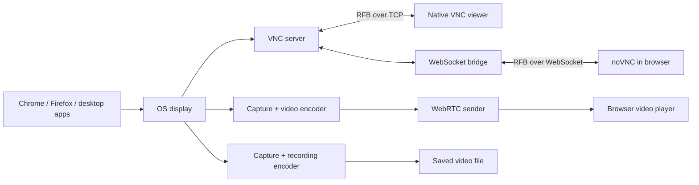
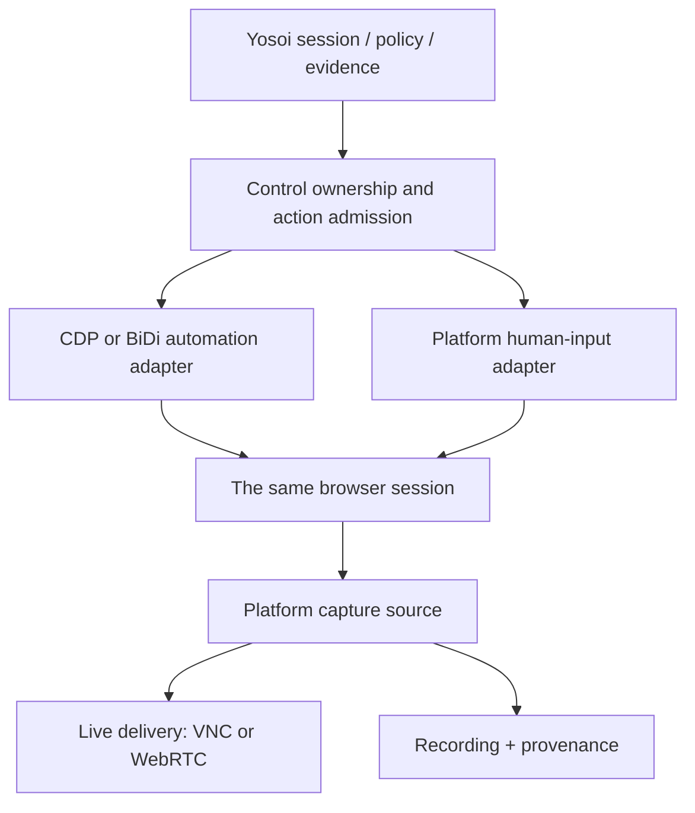
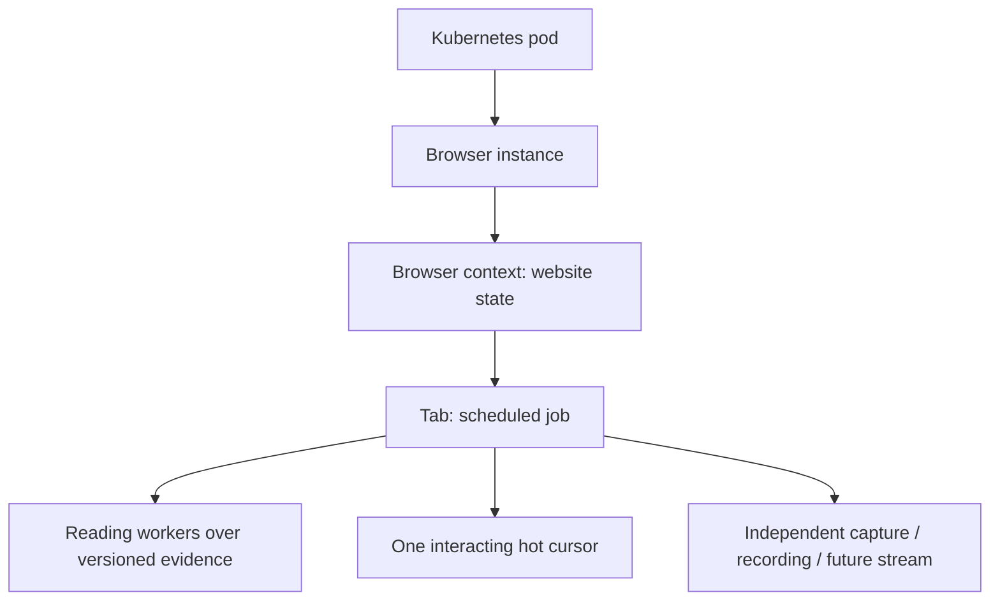
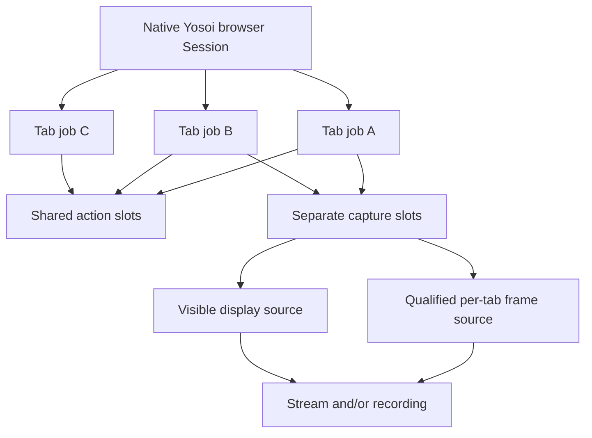

# Remote viewing architecture, from pixels to Yosoi

VNC, noVNC, WebRTC, Neko and Kernel occupy different layers. Products often
package several layers together, which makes them look like interchangeable
"VNC flavors." Separating them makes the future desktop work easier to reason
about.

## The two live-view paths

**VNC** is a remote desktop system built around the Remote Framebuffer (RFB)
protocol. A server reads the remote screen, sends updates, and processes input.
A client displays those updates and sends input back. Different servers can
share an existing desktop or provide a virtual desktop. Platform integration,
encodings, authentication, clipboard and extensions differ between products.

**noVNC** is the JavaScript browser client. Its core handles RFB, rendering and
input. Browsers cannot normally open arbitrary TCP sockets, so a WebSocket
bridge commonly carries the RFB bytes between noVNC and the VNC server.
`websockify` is a common bridge; this lab includes a small equivalent for the
experiment. noVNC itself is neither a desktop server nor a recording service.
It is predominantly JavaScript; WASM is not a prerequisite. See
[noVNC embedding](https://novnc.com/noVNC/docs/EMBEDDING.html) and
[its API](https://github.com/novnc/noVNC/blob/master/docs/API.md).

**WebRTC** carries real-time media and optionally data. The remote machine
captures and encodes the display, and the viewing browser's native media engine
handles receiving, decoding and playback. The application still supplies the
capture source, input handling, authentication and session policy. It can carry
input on a data channel or a separate connection; this lab uses a WebSocket.
Moving code to WASM would not by itself improve on the browser's native codecs
or fix slow capture. See [WebRTC peer connections](https://webrtc.org/getting-started/peer-connections).

**Recording** is another consumer of the session's pixels or encoded media.
It need not depend on VNC, noVNC, CDP or BiDi. Recording the server-side source
captures what happened there; recording the received stream captures what that
viewer received. These have different evidence meanings, particularly during
packet loss, disconnects or dropped frames.

## What makes a WebRTC connection work?

1. **Signaling:** our HTTP `/offer` endpoint exchanges SDP descriptions of media
   and connectivity. WebRTC does not prescribe the application's signaling API.
2. **ICE:** peers gather possible network addresses and select a usable path.
3. **STUN:** helps discover externally visible addresses. This is not a video relay.
4. **TURN:** relays traffic when direct connectivity cannot be established.
   Running a web server/reverse proxy alone does not solve media connectivity.
5. **Media:** negotiated codecs encode frames; the receiver balances timing,
   packet loss and jitter. A larger jitter buffer can improve smoothness while
   increasing delay.

The lab uses host candidates, no external STUN/TURN, and a local viewer. A
production system needs a declared network topology and relay strategy. An
ordinary HTTP port-forward does not automatically forward WebRTC media.

## Why Neko and Kernel are more than viewers

[Neko](https://neko.m1k1o.net/docs/v3/configuration/capture) captures and encodes
through GStreamer and delivers video using WebRTC. It also manages users,
control and the shared-desktop experience. It is an alternative complete stack
to a VNC-based stack; it is not simply another noVNC skin.

[Kernel's open-source images](https://github.com/kernel/kernel-images) offer
noVNC and WebRTC viewing modes, browser automation endpoints, and a separate
recording API. A wrapper coordinates these components into a usable session.
The quality of that coordination can matter as much as the protocol: resizing,
clipboard, reconnects, encoder tuning, resource usage and ownership.

Neither product's public feature list establishes our measured latency or
cross-platform suitability. Compare the maintained stacks before deciding to
own a custom streaming implementation long term.

## Where Yosoi belongs

This is a proposed boundary, not an implemented SDK interface. Yosoi should know
which session, display, capture backend, controller and recording belong
together. Human takeover must be coordinated with the action dispatcher:
stop accepting automation actions, settle in-flight work, grant human control,
and return control deliberately. A button that changes the viewer's state
cannot stop a CDP script already running.

Capture can be protocol-agnostic while automation remains protocol-specific.
Chrome keeps CDP and Firefox keeps BiDi. The recording layer sees pixels rather
than those commands. A desktop app could use the same viewing infrastructure
without implementing either browser protocol.

## What the concurrent A/V run changes

The [reviewed evidence](evidence/README.md) now demonstrates two independent
Chrome tab A/V sources, simultaneously recorded in separate disposable contexts
of one browser instance. The selected YouTube movies remained distinct; when
one was paused, its decoded audio was silent while the other's stayed audible.
Andrew reviewed and accepted the clips. This is a useful capability result,
not a capacity benchmark or a cross-platform certification.

The experiment uses browser-native `getDisplayMedia`, Region Capture and
`MediaRecorder`, driven by Yosoi's native browser provider. It does not require
a noVNC client or a VNC server. A future WebRTC sender could consume those
MediaStreams, but the per-tab live delivery path was not tested here.

The ownership hierarchy can therefore be planned as:

The tab is the scheduling and control unit; the browser and pod retain shared
resource and failure domains. Contexts are optional grouping boundaries: jobs
can deliberately share website state within a context, or request separate
contexts. An ordinary tab is not automatically an isolated account/session.
Readers consume bounded evidence; hot authority owns effects. Independent
recording does not imply independent CPU/GPU capacity or OS/VM isolation.

This spike implements local experiments, not the Kubernetes scheduler. The
next design should keep retained-tab, executing-action, reader and capture/
encoder limits distinct, and correlate tab identity, media clocks, receipts,
checkpoints and recovery. A tab can wait without occupying an action slot while
its independently admitted recording continues.

## One browser, N scheduled tabs

Yosoi's Rust Session already owns multiple tabs through `new_tab()`, with a
separate `Work` lease per tab and a shared execution pool. The current policy
admits 1–32 tabs; it is a bounded substrate rather than a completed job scheduler.
The worker in this spike deliberately qualifies one tab first.

Keep three capacities distinct: retained tabs, active automation actions, and
active captures/encoders. A tab can retain a job while it waits, releases an
action slot, continues an admitted recording, or has capture disabled.
Yielding an automation slot does not stop that page's scripts, network or CPU use.

This changes the earlier preference for display-only recording. The useful
shared boundary is a recording contract with frame-source capabilities:

- **Visible-session capture:** this spike's X11/display source records the
  foreground tab plus browser UI. Switching tabs changes the recorded content.
- **Concurrent tab capture:** needs a qualified source per tab. Cropping the
  desktop does not create hidden-tab pixels. Capture setup, background
  rendering, tab closure/navigation and resource limits need explicit tests.
- **Scheduled foreground capture:** a scheduler could bring a tab to the front
  only while its capture slot is active. Any gaps must be represented explicitly;
  that is not a continuous recording of every background tab.

[Chrome tabCapture](https://developer.chrome.com/docs/extensions/reference/api/tabCapture)
is one engine-specific candidate with audio/video streams. Its extension
invocation and granted-tab-access requirements apply; it is not a generic
unattended N-tab capture promise. The current native Chrome profile disables
extensions, so adopting this candidate would introduce a separately qualified
extension backend. CDP or other engine-native capture could also sit behind the
shared contract if its quality and lifecycle qualify. BiDi engines require
their own qualified sources; the transport cannot supply missing frames.

Ordinary tabs sharing a profile/context share cookies and storage. Per-tab Work
leases separate control authority, not website identity or security isolation.
Separate-context/profile support needs its own explicit design and API checks.

## Extending the platform backend

| Environment | Capture/input investigation | What can stay shared |
| --- | --- | --- |
| Linux X11, this lab | Xvfb, x11grab, x11vnc, XTest via xdotool | Session ownership, viewer, transport, recording metadata |
| Hyprland / Wayland | PipeWire + desktop portal or qualified compositor capture; separately qualify input and VNC server compatibility | Same conceptual session and viewer layers |
| Windows 11 | Native Windows capture and input, or a qualified Windows VNC server | noVNC client and/or WebRTC viewer, session/evidence contracts |
| Moli | Separate headless renderer capture qualification | Viewer and artifact contracts where supported |

Xvfb is an X server that draws into memory. It supplies a persistent display
without a physical monitor. A VNC server and FFmpeg can read it independently.
It does not exercise Hyprland, Wayland or the user's physical desktop.

Hyprland documents [PipeWire and its desktop portal for screen sharing](https://wiki.hypr.land/Useful-Utilities/Screen-Sharing/).
Capturing an XWayland window does not establish capture of the entire Wayland
desktop. [wayvnc](https://github.com/any1/wayvnc) is one VNC server to investigate,
but compatibility must be checked against the exact compositor/protocol
versions. No Wayland support is established by the X11 lab.

On Windows, Microsoft's [Desktop Duplication API](https://learn.microsoft.com/en-us/windows/win32/direct3ddxgi/desktop-dup-api)
provides desktop image updates. [SendInput](https://learn.microsoft.com/en-us/windows/win32/api/winuser/nf-winuser-sendinput)
injects input subject to Windows integrity restrictions. These are candidate
building blocks, not a working Windows backend or a guarantee for elevated
windows, secure desktops, multiple users or locked sessions.

## Measuring what the user feels

- **Capture-to-visible delay:** time from a known change on the remote display
  to the corresponding frame on the viewer.
- **Input-to-visible-response:** time from an input event at the viewer to the
  visible effect returned through capture and transport.
- **Input acknowledgement:** time until a server accepts/executes a command.
  This excludes the return video path and cannot stand in for visible response.
- **Frame rate:** distinguish captured, encoded, sent, decoded and rendered
  frames. A 30 fps file declaration alone does not prove 30 unique frames.
- **Conditions:** declare resolution, motion, codec, network delay/loss,
  viewers, recording state, CPU/GPU and bandwidth.

The first useful comparison should hold the display and workload constant,
then compare native VNC, noVNC and WebRTC. Test typing/static text as well as
scrolling/animation: compression choices that make motion smooth can make text
less sharp. Repeat with recording on to expose shared resource contention.
